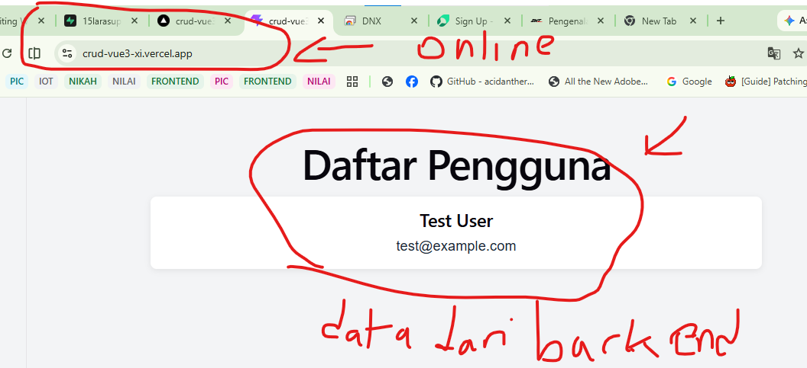

# Membuat Aplikasi Vue dengan Vite, Mengonsumsi API dengan Axios, dan Deploy ke Vercel

## 1. Pendahuluan

Vue.js adalah framework JavaScript untuk membangun antarmuka pengguna. Pada materi ini kita akan membuat aplikasi Vue 3 menggunakan Vite, mengambil data dari API menggunakan Axios, lalu menyiapkan aplikasi frontend untuk di-deploy ke Vercel.

API menyediakan data yang dapat digunakan aplikasi lain. Vue bertugas menampilkan data tersebut, sedangkan Axios membantu mengirim HTTP request seperti `GET` dan `POST`.

---

## 2. Tujuan Pembelajaran

Setelah mempelajari materi ini, siswa diharapkan mampu:

- membuat proyek Vue 3 menggunakan Vite;
- menjalankan dan memahami struktur dasar proyek Vue;
- memasang Axios dan menggunakannya untuk mengambil data API;
- menampilkan data serta menangani status loading dan error;
- mengatur URL API menggunakan environment variable;
- melakukan build dan deploy aplikasi Vue ke Vercel.

---

## 3. Persiapan

Pastikan perangkat sudah memiliki:

- Node.js versi LTS dan npm;
- Visual Studio Code;
- browser;
- akun GitHub dan Vercel untuk bagian deployment.

Periksa instalasi Node.js dan npm melalui terminal:

```bash
node -v
npm -v
```

---

## 4. Membuat Proyek Vue dengan Vite

Vite adalah alat untuk menjalankan server pengembangan dan membangun aplikasi frontend. Salah satu cara praktis membuat proyek Vue 3 adalah menggunakan `create-vue`, yang membuat proyek Vue dengan Vite.

1. Buka terminal pada folder tempat proyek akan disimpan.
2. Jalankan perintah:

   ```bash
   npm create vite@latest vue_dnx -- --template vue
   ```
   ikuti perintah atau pertanyaannya

7. Buka alamat lokal yang ditampilkan di terminal, biasanya `http://localhost:5173`.

Untuk menghentikan server, tekan `Ctrl+C` di terminal.

---

## 5. Mengenal Struktur Proyek

Beberapa file dan folder penting:

```text
belajar-vue-api/
├── public/             # File statis
├── src/
│   ├── assets/         # Aset seperti CSS dan gambar
│   ├── components/     # Komponen Vue yang dapat digunakan kembali
│   ├── App.vue         # Komponen utama aplikasi
│   └── main.js         # Titik awal aplikasi
├── index.html
└── package.json        # Script dan dependency proyek
```

Untuk materi ini, file yang akan dibuat atau diubah adalah `src/services/api.js` dan `src/App.vue`.

---

## 6. Memasang Axios

Axios adalah library untuk melakukan HTTP request dari aplikasi JavaScript.

Di terminal, pastikan berada di folder proyek, lalu jalankan:

```bash
npm install axios
```

Setelah terpasang, Axios dapat diimpor ke file JavaScript atau komponen Vue.

---

## 7. Mengatur URL API

Pada materi ini kita akan menggunakan API Laravel berikut untuk mengambil data pengguna:

```text
https://15larasupalagi.vercel.app/api/api/users
```

Buat file `.env.local` di folder utama proyek. Isi `VITE_API_BASE_URL` dengan alamat dasar server (tanpa path endpoint):

```env
VITE_API_BASE_URL=https://15larasupalagi.vercel.app
```

Vite hanya mengekspos environment variable yang namanya diawali `VITE_` ke kode frontend. Jangan menyimpan password, token rahasia, atau API key privat di variable `VITE_*`, karena nilainya dapat dibaca oleh pengguna aplikasi.

Buat folder `src/services`, lalu buat file `src/services/api.js`:

```javascript
import axios from 'axios'

const api = axios.create({
  baseURL: import.meta.env.VITE_API_BASE_URL,
  headers: {
    Accept: 'application/json',
  },
})

export default api
```

`axios.create()` membuat konfigurasi Axios yang dapat digunakan bersama oleh berbagai komponen. `baseURL` menjadi alamat dasar, sehingga request ke `/api/api/users` akan dikirim ke `https://15larasupalagi.vercel.app/api/api/users`.

> Setelah mengubah file `.env.local`, hentikan dan jalankan ulang `npm run dev` agar Vite membaca konfigurasi terbaru.

---

## 8. Mengambil dan Menampilkan Data API

Ganti isi `componen/helloworld.vue` dengan kode berikut:

```vue
<script setup>
import { onMounted, ref } from 'vue'
import api from '../services/api'

const users = ref([])
const isLoading = ref(true)
const errorMessage = ref('')

async function loadUsers() {
  isLoading.value = true
  errorMessage.value = ''

  try {
    const response = await api.get('/api/api/users')
    users.value = response.data.data
  } catch (error) {
    errorMessage.value =
      error instanceof Error ? error.message : 'Terjadi kesalahan saat mengambil data.'
  } finally {
    isLoading.value = false
  }
}

onMounted(loadUsers)
</script>

<template>
  <main class="container">
    <h1>Daftar Pengguna</h1>

    <p v-if="isLoading">Memuat data...</p>
    <p v-else-if="errorMessage" class="error">
      Gagal mengambil data: {{ errorMessage }}
    </p>
    <p v-else-if="users.length === 0">Data pengguna tidak ditemukan.</p>

    <ul v-else class="user-list">
      <li v-for="user in users" :key="user.id" class="user-card">
        <h2>{{ user.name }}</h2>
        <p>{{ user.email }}</p>
      </li>
    </ul>
  </main>
</template>

<style>
* {
  box-sizing: border-box;
}

body {
  margin: 0;
  background: #f3f4f6;
  color: #1f2937;
  font-family: Arial, sans-serif;
}

.container {
  width: min(800px, calc(100% - 32px));
  margin: 40px auto;
}

.user-list {
  display: grid;
  gap: 16px;
  padding: 0;
  list-style: none;
}

.user-card {
  padding: 16px;
  border-radius: 8px;
  background: white;
  box-shadow: 0 2px 8px rgb(0 0 0 / 8%);
}

.user-card h2 {
  margin-top: 0;
  text-transform: capitalize;
}

.error {
  color: #b91c1c;
}
</style>
```

### Penjelasan

- `ref()` membuat state reaktif. Perubahan nilainya akan memperbarui tampilan.
- `onMounted()` menjalankan `loadUsers()` setelah komponen ditampilkan.
- `api.get()` mengirim HTTP `GET` ke endpoint `/api/api/users`.
- API membungkus hasilnya dalam objek dengan properti `success`, `message`, dan `data`. Daftar pengguna berada di `response.data.data`.
- Axios menyimpan isi response server di `response.data`.
- `try`, `catch`, dan `finally` digunakan untuk menangani hasil sukses, error, dan akhir proses request.
- `v-for` membuat satu elemen untuk setiap pengguna. `:key` membantu Vue melacak setiap elemen dengan stabil.

Simpan file dan periksa browser. Aplikasi seharusnya menampilkan pengguna yang dikirim oleh API.

---


## 11. Build dan Deploy ke Vercel

### Menyiapkan dan menguji build

Sebelum deployment, jalankan perintah berikut:

```bash
npm run build
```

Vite akan menghasilkan file production di folder `dist`. Untuk melihat hasil build secara lokal, jalankan:

```bash
npm run preview
```

### Deploy melalui GitHub

1. Simpan dan push proyek ke repository GitHub. Jangan push file `.env.local` jika berisi konfigurasi lokal atau data sensitif.
2. Masuk ke Vercel dan pilih **Add New → Project**.
3. Import repository proyek Vue dari GitHub.
4. Pastikan framework terdeteksi sebagai **Vite**. Konfigurasi umumnya:
   - Build Command: `npm run build`
   - Output Directory: `dist`
   - Install Command: `npm install`
5. Pada **Environment Variables**, tambahkan:
   - Name: `VITE_API_BASE_URL`
   - Value: `https://15larasupalagi.vercel.app`
6. Pilih **Deploy**.
7. Setelah deployment selesai, buka URL yang diberikan Vercel dan uji apakah data berhasil dimuat.

Setiap kali mengubah environment variable di Vercel, lakukan deployment ulang agar nilai baru digunakan oleh build frontend.

---
## 11.1 Hasil
 jika dibuka akan seperti ini 
 

## 12. Troubleshooting

| Masalah | Kemungkinan penyebab dan solusi |
|---|---|
| `npm` atau `node` tidak dikenali | Instal Node.js LTS, lalu tutup dan buka kembali terminal. |
| Halaman tidak menampilkan data | Periksa URL API, endpoint, koneksi internet, dan tab **Network** di Developer Tools browser. |
| Error CORS | Izinkan domain frontend pada konfigurasi CORS backend. |
| `baseURL` bernilai kosong | Periksa ejaan `VITE_API_BASE_URL`, pastikan file `.env.local` berada di folder utama, lalu mulai ulang server Vite. |
| Berhasil di lokal tetapi gagal di Vercel | Pastikan variable `VITE_API_BASE_URL` sudah diatur pada project Vercel dan lakukan redeploy. |
| Data berisi error 404 | Cocokkan endpoint yang dipanggil dengan route yang tersedia pada API. |

---


## 9. Contoh Request Lain dengan Axios

Selain `GET`, Axios menyediakan method seperti `POST`, `PUT`, `PATCH`, dan `DELETE`.

Contoh bentuk pemanggilan `POST` (gunakan hanya jika endpoint backend memang mendukung pembuatan pengguna):

```javascript
const response = await api.post('/api/api/users', {
  name: 'Nama Pengguna',
  email: 'pengguna@example.com',
  password: 'password-yang-aman',
})

console.log(response.data)
```

Method HTTP yang tersedia, field yang wajib dikirim, dan aturan autentikasi bergantung pada backend. Jangan mengirim password atau data nyata saat latihan tanpa izin; API yang diberikan pada materi ini digunakan untuk membaca daftar pengguna dengan `GET`.

---

## 10. Memahami dan Menguji API Laravel

Endpoint yang digunakan pada materi ini:

```text
GET https://15larasupalagi.vercel.app/api/api/users
```

URL pada `.env.local` berisi domain saja, sedangkan path `/api/api/users` ditambahkan pada pemanggilan `api.get()`. Respons API memiliki bentuk seperti berikut:

```json
{
  "success": true,
  "message": "Detail data berhasil diambil",
  "data": [
    {
      "id": 1,
      "name": "Test User",
      "email": "test@example.com"
    }
  ]
}
```

Karena daftar pengguna ada di dalam properti `data`, kode Vue mengambilnya menggunakan `response.data.data`.

Jika browser menampilkan error CORS, periksa konfigurasi CORS di backend Laravel. Server API harus mengizinkan origin tempat aplikasi Vue berjalan, termasuk domain Vercel yang digunakan. CORS tidak dapat diperbaiki hanya dengan mengubah kode Axios di frontend.


## 13. Latihan

1. Tampilkan ID pengguna pada setiap kartu.
2. Buat tombol **Muat Ulang** untuk menjalankan kembali `loadUsers()`.
3. Tampilkan pesan yang berbeda jika properti `success` pada respons bernilai `false`.
4. Deploy hasil latihan ke Vercel dan kumpulkan URL aplikasi.

---

## 14. Kesimpulan

Vue 3 dengan Vite dapat digunakan untuk membangun aplikasi frontend dengan cepat. Axios memudahkan aplikasi melakukan HTTP request ke API. Dalam aplikasi yang siap digunakan, tampilkan status loading, tangani error, dan simpan URL API dalam environment variable. Setelah build berhasil, aplikasi Vue dapat di-deploy ke Vercel dengan output directory `dist`.

---

## 15. Referensi

- [Dokumentasi Vue](https://vuejs.org/guide/)
- [Dokumentasi Vite](https://vite.dev/guide/)
- [Dokumentasi Axios](https://axios-http.com/docs/intro)
- [Dokumentasi Vercel untuk Vite](https://vercel.com/docs/frameworks/frontend/vite)
